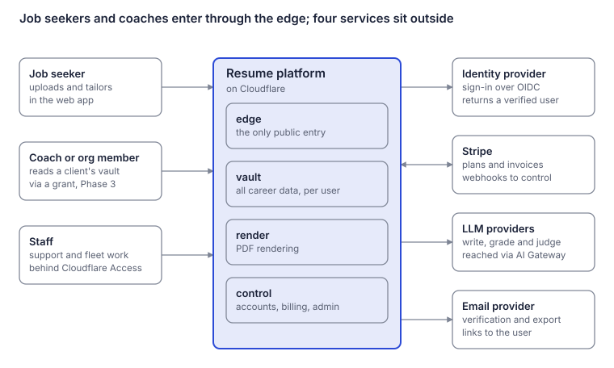
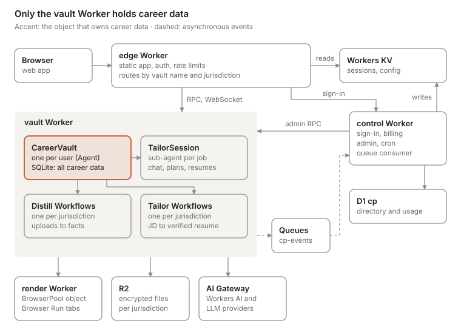
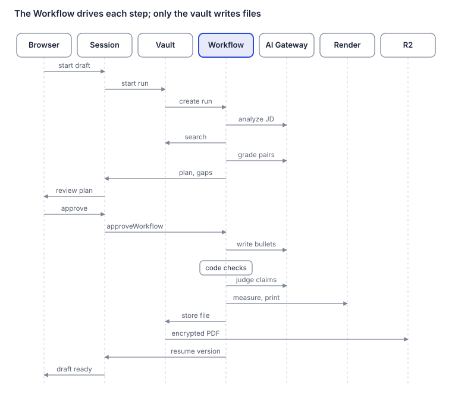

# Agentic Resume Builder: Technical Architecture

> Exported on 2026-11-04 from the living design document. Diagrams are rendered snapshots in [diagrams](diagrams).

Nov 3, 2026 · @Evan Klein

## Overview

**This document specifies how the platform is built and run: four Workers, two Durable Object classes, a Distill and a Tailor Workflow per jurisdiction, and the stores around them.** Product behavior, the grounding rules and the reasoning behind each choice live in the system design: [Agentic Resume Builder on Cloudflare: System Design](system-design.md).

- **In scope:** deployable units, bindings and configuration; public and internal interfaces; model input and output contracts; data placement; security, delivery, operations and testing.
- **Out of scope:** UI design, pricing and go-to-market. The recruiter marketplace in the system design is not yet specified here; the additions it needs, from new Workers to ADRs, are listed in the November 2026 design review in the repository.

**Quality goals, in priority order**

| # | Goal | Target |
| --- | --- | --- |
| 1 | Groundedness | Zero unsupported claims on the regression set; under 1 per 10,000 shipped bullets at 95% confidence |
| 2 | Isolation and privacy | Each user's full career record in its own database; EU users' career data stored only in the EU |
| 3 | Data-plane availability | Signed-in users unaffected by control-plane outages; vault API at 99.9% a month |
| 4 | Latency | Vault reads under 100 ms p95; first tailored draft under 90 s p95 |
| 5 | Cost | Cloudflare cost under $0.01 per Tailor run; model tokens tracked per stage |

**Constraints**

- The runtime is Cloudflare only: Workers, Durable Objects with SQLite, D1, KV, R2, Queues, Workflows, Workers AI, AI Gateway and Browser Run. The outside dependencies are the identity provider, Stripe, LLM providers and a transactional email provider.
- TypeScript throughout, with the Agents SDK for the vault and its sessions.
- Workers Paid limits apply; the system design lists the ones that shape the design.

**Conventions.** The Workers are named `edge`, `vault`, `render` and `control`. IDs are ULIDs with a type prefix (`usr_`, `v_`, `app_`, `run_`, `fct_`). A jurisdiction is one of `none`, `eu`, `us` or `fedramp`; fedramp needs an Enterprise contract and has no bindings yet.

## System context

**People reach the platform through two doors, the edge for users and Cloudflare Access for staff, and the platform depends on four outside services.** Everything else runs on Cloudflare.



Stripe is the one two-way link: the platform calls its API, and its webhooks call back into `control`.

## Containers

**Only the `vault` Worker holds career data; `edge` routes to it, `render` produces PDFs for it, and `control` reaches it through admin RPC and hears back through the queue.**



The vault starts every Workflow, including Tailor runs that a session asks for, so one registry can stop them all at erasure. Workflow steps reach R2 and the render Worker through the vault's bindings.

## Deployable units and bindings

**Four Workers deploy separately: `edge` is the only one users reach, `vault` owns all career data, `render` owns browsers, and `control` owns the control plane.** The split lets edge and control code ship without restarting vault objects, and keeps every Durable Object class that holds career data in one script.

| Worker | Public routes and triggers | Exports | Bindings |
| --- | --- | --- | --- |
| `edge` | `app.<domain>/*`; `eu.app.<domain>/*` under Regional Services for EU users | `fetch`: static assets, `/api/*`, `/agents/*` | `ASSETS`; `VAULT` (Durable Object namespace from `vault`); `SESSIONS``  (KV, read-write), CONFIG (KV); JWT_KEY (Secrets Store `); `RL_USER`, `RL_IP` (Rate Limiting); `CONTROL` (service binding); `METRICS` (Analytics Engine) |
| `vault` | None: reachable only through bindings | `CareerVault` (Agent), `TailorSession` (sub-agent), Distill and Tailor Workflow classes, one per jurisdiction | `AI`; `FILES`, `FILES_EU`, `FILES_US` (R2); `DISTILL*`, `TAILOR*` (Workflows); `CP_EVENTS` (Queue producer); `RENDER` (service binding); `CONFIG` (KV); `TAXONOMY` (Vectorize); `KEK*` (Secrets Store); `METRICS` |
| `render` | None | `Render` (RPC entrypoint), `BrowserPool` (Durable Object) | `BROWSER` (Browser Run); `BROWSER_POOL` |
| `control` | `hooks.<domain>/stripe`; `admin.<domain>/*` behind Cloudflare Access; sign-in reached from `edge`; Cron Triggers; Queue consumers | `fetch`, `scheduled`, `queue` | `CP_DB` (D1); `SESSIONS`, `CONFIG` (KV, read-write); `VAULT` (namespace from `vault`); consumer of `cp-events` and its dead-letter queue; `FLEET_OPS` (Queue); `JWT_KEY`, `ADMIN_KEY`, `STRIPE_KEY` (Secrets Store); `METRICS` |

`vault` and `render` turn off `workers.dev` and preview URLs, so only bound Workers can call them. That is what lets the vault trust the verified claims `edge` attaches to each call.

**`vault` configuration (excerpt; the `us` variants repeat the `eu` pattern)**

```jsonc
{
  "name": "vault",
  "main": "src/index.ts",
  "compatibility_date": "2026-11-01",
  "compatibility_flags": ["nodejs_compat"],
  "workers_dev": false,
  "preview_urls": false,
  "limits": { "cpu_ms": 300000 },
  "durable_objects": {
    "bindings": [{ "name": "VAULT", "class_name": "CareerVault" }]
  },
  "exports": { "CareerVault": { "type": "durable-object", "storage": "sqlite" } }, // declarative; replaces the legacy migrations field
  "workflows": [
    { "name": "distill", "binding": "DISTILL", "class_name": "DistillWorkflow" },
    { "name": "distill-eu", "binding": "DISTILL_EU", "class_name": "DistillWorkflowEu", "jurisdiction": "eu" },
    { "name": "tailor", "binding": "TAILOR", "class_name": "TailorWorkflow" },
    { "name": "tailor-eu", "binding": "TAILOR_EU", "class_name": "TailorWorkflowEu", "jurisdiction": "eu" }
  ],
  "r2_buckets": [
    { "binding": "FILES", "bucket_name": "files" },
    { "binding": "FILES_EU", "bucket_name": "files-eu", "jurisdiction": "eu" }
  ],
  "queues": { "producers": [{ "binding": "CP_EVENTS", "queue": "cp-events" }] },
  "services": [{ "binding": "RENDER", "service": "render", "entrypoint": "Render" }],
  "kv_namespaces": [{ "binding": "CONFIG", "id": "<config-namespace-id>" }],
  "ai": { "binding": "AI" },
  "vectorize": [{ "binding": "TAXONOMY", "index_name": "skills-taxonomy" }],
  "analytics_engine_datasets": [{ "binding": "METRICS", "dataset": "pipeline" }],
  "secrets_store_secrets": [
    { "binding": "KEK", "store_id": "<store-id>", "secret_name": "vault-kek" },
    { "binding": "KEK_EU", "store_id": "<store-id>", "secret_name": "vault-kek-eu" }
  ],
  "observability": {
    "logs": { "enabled": true },
    "traces": { "enabled": true, "head_sampling_rate": 0.1 }
  }
}
```

**`edge` configuration (excerpt)**

```jsonc
{
  "name": "edge",
  "assets": { "directory": "./dist", "binding": "ASSETS", "not_found_handling": "single-page-application",
              "run_worker_first": ["/api/*", "/agents/*"] },
  "durable_objects": {
    "bindings": [{ "name": "VAULT", "class_name": "CareerVault", "script_name": "vault" }]
  },
  "services": [{ "binding": "CONTROL", "service": "control" }],
  "kv_namespaces": [
    { "binding": "SESSIONS", "id": "<sessions-namespace-id>" },
    { "binding": "CONFIG", "id": "<config-namespace-id>" }
  ],
  "ratelimits": [
    { "name": "RL_USER", "namespace_id": "1001", "simple": { "limit": 300, "period": 60 } },
    { "name": "RL_IP", "namespace_id": "1002", "simple": { "limit": 600, "period": 60 } }
  ]
}
```

**Configuration rules**

- Only `CareerVault` needs a binding and an exports entry; `TailorSession` runs as a [sub-agent](https://developers.cloudflare.com/agents/api-reference/sub-agents/) of it.
- Each jurisdiction gets its own Workflow, because a Workflow's [jurisdiction is fixed at creation](https://developers.cloudflare.com/workflows/reference/data-location/) and must be set in the Worker that defines it. The EU classes are empty subclasses (`class TailorWorkflowEu extends TailorWorkflow {}`).
- Keep esbuild's `keep_names` on: [AgentWorkflow callbacks](https://developers.cloudflare.com/agents/api-reference/run-workflows) route back by class name.
- Changes to a Durable Object class's lifecycle (a new, renamed, deleted or transferred class) cannot ship as a [gradual deployment](https://developers.cloudflare.com/workers/versions-and-deployments/gradual-deployments/with-durable-objects/). Code changes to existing classes can, with each object pinned to one version; lifecycle changes go out alone with `wrangler deploy`.

## Interfaces

**Clients talk only to `edge`, over HTTPS and WebSockets; behind it everything is typed Workers RPC, one queue topic and Workflow parameters, all defined in a shared `contracts` package.** Workers and Durable Objects deploy independently and can run mixed versions during a rollout, so every contract change is additive first and removals follow later (expand, then contract).

**Public API, served by `edge`**

| Method and path | Purpose | Handled by |
| --- | --- | --- |
| `POST /api/auth/session` | Exchange the identity provider's code for tokens | `control` |
| `POST /api/auth/refresh` | Rotate the refresh token and issue an access token | `edge`, checked against the session record in the vault, which KV caches |
| `GET /api/vault` | Summary: roles, counts, question inbox | vault |
| `POST /api/vault/sources` | Upload a file or paste text; starts Distill | vault |
| `GET /api/vault/sources/{id}` | Processing status and extracted facts | vault |
| `PATCH /api/vault/roles/{id}` | Confirm or edit a role | vault |
| `PATCH /api/vault/facts/{id}` | Confirm, edit or reject a fact | vault |
| `POST /api/vault/questions/{id}/answer` | Answer a question, attached to a role the user picks | vault |
| `POST /api/vault/conflicts/{id}/resolve` | Choose or correct the value in a conflict | vault |
| `POST /api/applications` | Create an application from a JD (text or URL) | vault, which spawns a session |
| `POST /api/applications/{id}/drafts` | Start a Tailor run | session, then vault |
| `POST /api/applications/{id}/drafts/{run}/approve` | Approve the plan, with pins and drops | session |
| `GET /api/applications/{id}/resumes/{version}.{pdf,docx}` | Download a rendered resume | session, then R2 |
| `GET`, `POST`, `DELETE /api/grants` | List, create and revoke sharing grants | vault |
| `POST /api/account/export`, `POST /api/account/erase` | Request export or erasure; an export arrives as a signed, one-time download link that carries its archive key | `control` |
| `WS /agents/career-vault/{vault}/sub/tailor-session/{application}` | Chat, plan review and live progress | session |

**Internal RPC**

```ts
// contracts/src/rpc.ts
type Jurisdiction = 'none' | 'eu' | 'us' | 'fedramp';

/** Verified claims that edge attaches to every user-facing call. */
interface Caller {
  userId: string; vault: string; jur: Jurisdiction;
  generation: number; entVersion: number; grantId?: string;
  aud: string;               // the hostname the token was issued for
  ent?: SignedEntitlements;  // attached by edge when entVersion is newer than the vault's copy
}

/** Short-lived Ed25519-signed token minted by control; the vault holds the public key. */
interface AdminAuth {
  op: string; vault: string; jur: Jurisdiction;
  paramsHash: string; nonce: string; exp: number; sig: string;
}

/** CareerVault, called by edge. The vault re-checks the Caller on every call. */
interface VaultApi {
  summary(c: Caller): Promise<VaultSummary>;
  addSource(c: Caller, input: SourceInput): Promise<{ sourceId: string }>;
  updateRole(c: Caller, id: string, patch: RolePatch): Promise<Role>;
  updateFact(c: Caller, id: string, patch: FactPatch): Promise<Fact>;
  answerQuestion(c: Caller, id: string, roleId: string, text: string): Promise<{ sourceId: string }>;
  resolveConflict(c: Caller, id: string, choice: ConflictChoice): Promise<void>;
  createApplication(c: Caller, jd: JobInput): Promise<{ applicationId: string }>;
  setGrant(c: Caller, grant: GrantInput): Promise<Grant>;
}

/** CareerVault, called by control only. */
interface VaultAdmin {
  init(a: AdminAuth, cfg: VaultInit): Promise<{ schemaVersion: number }>;
  applyEntitlements(a: AdminAuth, version: number, ent: Entitlements): Promise<void>;
  freeze(a: AdminAuth, reason: string): Promise<void>;
  unfreeze(a: AdminAuth): Promise<void>;
  revokeSessions(a: AdminAuth): Promise<{ generation: number }>;
  export(a: AdminAuth, consent: ConsentToken): Promise<{ archiveKey: string }>;
  import(a: AdminAuth, archiveKey: string, transferKey: string): Promise<void>;
  erase(a: AdminAuth, nonce: string): Promise<ErasureReceipt>;
  restore(a: AdminAuth, bookmark: string, epoch: number, consent: ConsentToken): Promise<void>;
  runFleetOp(a: AdminAuth, op: FleetOp): Promise<FleetOpResult>;
  migrate(a: AdminAuth, target: number): Promise<void>;
  stats(a: AdminAuth): Promise<VaultStats>;
}

/** CareerVault, as sessions (through parentAgent()) and Workflow steps (through this.agent) see it. */
interface VaultForSessions {
  search(requirements: RequirementQuery[]): Promise<Candidate[]>;
  readFacts(ids: string[]): Promise<FactSnapshot[]>;
  reserveQuota(metric: 'tailor_run'): Promise<Reservation>;
  startTailorRun(applicationId: string, p: TailorParams): Promise<{ instanceId: string }>;
  approveRun(runId: string, decision: ApprovalDecision): Promise<void>;   // the vault started the run, so it approves it
  submitAnswers(applicationId: string, answers: AnswerInput[]): Promise<{ sourceIds: string[] }>;
  // The vault relays Workflow progress, plans and resume versions to the session that asked for the run.
  indexResume(applicationId: string, entry: ResumeIndexEntry): Promise<void>;
  putFile(key: string, bytes: ArrayBuffer, contentType: string): Promise<void>; // encrypts; key must sit under the vault's prefix
  getFile(key: string): Promise<ReadableStream>;                                // decrypts
}

/** render Worker entrypoint, called from Tailor Workflow steps. */
interface RenderApi {
  measure(html: string, page: PageSpec): Promise<{ pages: number; overflowPx: number }>;
  pdf(html: string, page: PageSpec): Promise<ArrayBuffer>;
}
```

**Queue events and Workflow parameters**

```ts
// contracts/src/events.ts: one topic, cp-events, delivered at least once
type CpEvent =
  | { type: 'usage.snapshot'; vault: string; jur: Jurisdiction; epoch: number; seq: number;
      period: string; metric: string; total: number }
  | { type: 'vault.stats'; vault: string; jur: Jurisdiction; epoch: number; seq: number;
      schemaVersion: number; storageBytes: number; factCount: number; lastActiveAt: number }
  | { type: 'grant.changed'; vault: string; grantId: string; grantee: string;
      scope: string; expiresAt?: number; revoked: boolean; epoch: number; seq: number };

// contracts/src/workflows.ts: parameters carry IDs only, never career text
interface DistillParams { vault: string; jur: Jurisdiction; sourceId: string; promptSet: string }
interface TailorParams {
  vault: string; jur: Jurisdiction; applicationId: string; runId: string;
  mode: 'review' | 'express'; promptSet: string; reservationId: string;
}
// Tailor steps: analyze-jd, retrieve, grade, select, approval,
// write:<roleId>, verify:<roleId>, fit, render, store
```

`promptSet` pins one prompt and model version for the whole run. The consumer applies `usage.snapshot``, vault.stats and grant.changed` only when (epoch, seq) is newer than what D1 holds.

## Model I/O contracts

**Every model call returns JSON that is validated against a schema before anything is stored, and the schemas are what make grounding checkable.** Facts carry their quote, each bullet names the fact behind every number and entity, and the judge returns one label per claim.

```ts
// contracts/src/model-io.ts

/** Distill step 4: one call per role block. */
interface ExtractionOutput {
  roles: { tempId: string; kind: RoleKind; org: string; title?: string;
           start?: string; end?: string; quote: string }[];
  accomplishments: { tempId: string; roleTempId: string; statement: string }[];
  facts: {
    tempId: string; accomplishmentTempId: string;
    type: 'action' | 'leadership' | 'skill' | 'scope' | 'metric' | 'outcome' | 'award';
    text: string;
    quote: string;                  // must appear verbatim in the role block
    workLevel?: 'contributed' | 'implemented' | 'led' | 'owned' | 'founded';
    peopleLevel?: 'mentored' | 'led_team' | 'managed';
    metric?: { what: string; value: number; unit: string; direction: 'up' | 'down';
               kind: 'change' | 'level'; better: 'higher' | 'lower';
               period?: string; baseline?: number };
    skills?: string[];
    sensitivity?: 'health' | 'family' | 'immigration' | 'pay' | 'age';
  }[];
}

/** Tailor stage 3. */
interface GradeOutput {
  grades: { requirementId: string; accomplishmentId: string;
            score: 0 | 1 | 2 | 3; factIds: string[] }[];
}

/** Tailor stage 6: one call per role; the writer has no tools. */
interface WriterOutput {
  bullets: {
    id: string; roleId: string; text: string;
    factIds: string[];                                   // every fact the bullet uses
    spans: { text: string; kind: 'number' | 'entity'; factId: string }[];
  }[];
  summary?: { clauses: { text: string; factIds: string[] }[] };
}

/** Tailor stage 7: the judge sees claims and evidence, never the JD. */
interface JudgeOutput {
  claims: { bulletId: string; claim: string;
            label: 'supported' | 'unsupported' | 'overstated';
            factIds: string[]; reason: string }[];
}
```

**Model routing per stage**

| Stage | Model tier | Settings | Fallback | Response cache |
| --- | --- | --- | --- | --- |
| Distill: extract | Mid-size, structured output | Temperature 0, schema-constrained | Second provider, same tier | Off |
| Distill: entailment check | Small | Temperature 0 | Second small model | Off |
| Distill: transcribe scans | Vision | Temperature 0 | Second provider | Off |
| Tailor: analyze JD | Small | Temperature 0 | Second provider | On, keyed by JD hash (holds no user data) |
| Tailor: grade | Small, batched | Temperature 0 | Second provider | Off |
| Tailor: write | Frontier, no tools | Low temperature, schema-constrained | Second frontier provider | Off; verified bullets are cached in the session |
| Tailor: judge | Mid or frontier, different family from the writer | Temperature 0 | Gate-approved, different-family models only; otherwise the draft waits | Off |

**Call rules**

- Output that fails validation gets one retry with the validation error attached; after that the step fails and the Workflow's own retry takes over.
- Prompts, schemas and model routes are versioned together as a `promptSet` in the registry, and a run uses one set from start to finish.
- Every call goes through AI Gateway with `cf-aig-collect-log-payload: false` and up to five [`cf-aig-metadata`](https://developers.cloudflare.com/ai-gateway/configuration/custom-metadata/) entries: a keyed hash of the vault name, run, stage and `promptSet`.
- Inputs mark untrusted text (JD, uploads) with delimiters, and instructions never come from inside them.

## Runtime view: a Tailor run

**A Tailor run crosses seven components, but only the Workflow holds the run's progress; every other hop is a short call it can retry.** The session is the user's window onto the run, and the vault is the only owner of career data.



The approval pause sits between grading and writing, and in express mode the session approves at once. A failed check sends the Workflow back to writing before it renders; that loop is left out of the drawing.

**Latency budget** (p95 targets per stage; user review time not counted)

| Stage | Budget | How it stays inside the budget |
| --- | --- | --- |
| Analyze JD | 6 s | Small model; cached when many users submit the same JD |
| Retrieve | 1 s | FTS5 and in-memory vectors inside the vault, then one rerank call |
| Grade | 12 s | Pairs batched on a small model |
| Select | 1 s | Code |
| Write | 25 s | Roles written in parallel |
| Verify | 15 s | Code checks take milliseconds; judge calls run in parallel |
| Fit and render | 8 s | A pooled browser tab measures, then prints |
| Store | 1 s | R2 write, session record, vault index |
| **Total** | **69 s** | Leaves 21 s under the 90 s target: a repair of only the failing bullets fits, a full write-and-verify round (about 40 s) does not, and the target excludes time spent waiting for approval |

## Data architecture

**In the seeker product, career data lives in exactly two places, the user's Durable Objects and the user's R2 prefix; every other store holds IDs, metadata or public reference data. The marketplace adds pseudonymous cards in index shards and shared snapshots in intro threads.** Full table schemas are in the system design.

| Store | Holds | Residency | Retention | Recovery |
| --- | --- | --- | --- | --- |
| Vault SQLite, one per user | Sources, evidence, roles, accomplishments, facts, vectors, questions, grants, audit, outbox | User's jurisdiction | Until erasure | Point-in-time recovery, 30 days |
| Session SQLite, one per application | JD, requirements, grades, plans, resume versions, chat | Same as the vault | Until the application or account is deleted | Restored with its vault (facet support to confirm) |
| R2 `files`, `files-eu`, `files-us` | Encrypted uploads, rendered PDF and DOCX, export archives | Jurisdictional bucket | Uploads until erasure; renders until their version is deleted; exports 7 days by lifecycle rule | None: the vault holds the evidence text, and renders can be regenerated |
| D1 `cp` | Accounts, users, vault directory, plans, two periods of usage, registries, erasure receipts | Default; EU shard when required | Account lifetime; receipts kept | Time Travel, 30 days |
| KV `sessions` | Session records: user, vault name, jurisdiction, generation, versions | Global | Expires with the refresh token | None needed: users sign in again |
| KV `config` | Registry snapshots: prompt sets, model routes, flags | Global | Current and previous snapshot | Rebuilt from D1 |
| Workflow instance state | Step status and outputs, which are IDs | Workflow's jurisdiction | 30 days after completion on Workers Paid | Not needed |
| Queues `cp-events`, `fleet-ops` | Snapshots and job descriptors, IDs only | Global | Until consumed; failures go to a dead-letter queue | Replay |
| Vectorize `skills-taxonomy` | Public skills taxonomy | Global | Versioned | Rebuilt from source |
| Analytics Engine, AI Gateway logs | Metrics and model-call metadata, no career text | Global | Analytics Engine keeps three months; gateway logs follow Workers Logs retention for accounts whose first gateway dates from 24 September 2026 or later, and automatic log deletion under Legacy Logs before that | Not needed |

**Keys and IDs**

- R2 keys: `{vaultName}/src/{sourceId}`, `{vaultName}/out/{applicationId}/{resumeId}.pdf` (and `.docx`), `{vaultName}/export/{exportId}.zip`. The bucket follows the vault's jurisdiction, and erasure deletes the `{vaultName}/` prefix.
- KV keys: `s:{sessionId}` for session records; `cfg:current` points at `cfg:{version}`, the snapshot.
- IDs are prefixed ULIDs. IDs that Distill creates for evidence, accomplishments and facts are hashes of source, span and field, so a retried step writes the same rows.
- Vault names are random (`v_` plus a ULID) and never derived from the user ID or email.

**File encryption.** The vault encrypts every file it stores with AES-256-GCM through Web Crypto, using a fresh 96-bit nonce per object and the object key as associated data. The data key is per user, wrapped by the jurisdiction's key-encryption key from Secrets Store, and never leaves the vault: Workflow steps and sessions read and write files through vault RPC.

**Migrations**

- D1: numbered SQL files applied by `wrangler d1 migrations apply` in the pipeline, always expand-then-contract.
- Vault and session SQLite: an ordered migration list in code, applied on wake. Schema changes run inside `blockConcurrencyWhile`, data backfills run as batches on the scheduler, and the version lives in `meta`.
- Vectors: each row records its embedding model, and upgrades re-embed in the background.

## Security architecture

**Each trust boundary has its own control that does not depend on the others: the public edge, the bound-only data plane behind it, the control plane, and the model providers outside Cloudflare.**

**Trust boundaries**

| Boundary | What crosses it | Controls |
| --- | --- | --- |
| Internet to `edge` | User requests, uploads, WebSockets | TLS, WAF managed rules, Turnstile on signup, Rate Limiting binding, token verification against cached public keys |
| `edge` to vault and sessions | RPC carrying a `Caller`; WebSocket upgrades | Only bound Workers can reach `vault`; the path must name the token's vault; the vault re-checks user, generation and grants |
| `control` to vault | Admin RPC | An Ed25519-signed `AdminAuth` on every call, scoped to one operation and expiring in 60 seconds |
| Vault and Workflows to model providers | Selected facts, JD text, prompts | AI Gateway with metadata-only logs; zero-retention provider terms; EU routes for EU vaults; a writer with no tools |
| Staff to admin tools | Support and fleet actions | Cloudflare Access with SSO; vault content only through a support grant the user approves |

**Tokens**

| Token | Format and lifetime | Contents | Revocation |
| --- | --- | --- | --- |
| Access token | JWT signed with Ed25519, 15 minutes | User, vault name, jurisdiction, session generation, plan, entitlements version; a grantee's token also names the grant and the owner's vault | Expires; the vault rejects older generations at once |
| Refresh token | Opaque, rotated on every use, 30 days | Points at the session record in the vault, which rotates it atomically and revokes the whole token family if an old token is reused; KV holds a cache | The vault bumps the generation, and control deletes the cached record |
| `AdminAuth` | Signed by control, 60 seconds, one operation | Operation, vault name, jurisdiction, parameter hash, nonce, expiry | Expires |

**Keys**

- Secrets Store holds the JWT signing key, the admin signing key, the Stripe key and one key-encryption key per jurisdiction; Workers read them through [bindings](https://developers.cloudflare.com/secrets-store/integrations/workers/). Model provider keys are stored for AI Gateway's bring-your-own-key feature, so no Worker handles them.
- Each vault creates its own data key in `init()`, wraps it with its jurisdiction's key-encryption key and keeps it in `meta`. Rotating a key-encryption key rewraps data keys as vaults wake.
- Token-verification public keys are published to KV `config`. Signing keys rotate every 90 days with a 30-day overlap.

**Threat model**

| Threat | Example | Mitigation |
| --- | --- | --- |
| Account takeover | A stolen refresh token | Atomic rotation in the vault, with the token family revoked on reuse; `revokeSessions()` bumps the generation and closes open sockets |
| Cross-tenant access | A request path names another user's vault | Path check in `edge`, owner check in the vault, no seeker endpoint that spans vaults (marketplace search is specified in the system design) |
| Forged control-plane call | A bug in `edge` calls `erase()` | Admin methods refuse anything without a valid `AdminAuth` |
| Leak through model logs | Prompts stored by the gateway or provider | Payload logging off, zero-retention terms, caching only for JD analysis |
| Prompt injection | A JD tells the model to add a skill | No writer tools; checks run against vault facts; the judge never sees the JD |
| Sensitive detail on a resume | Pay or visa status from an interview answer | Sensitivity tags at extraction; opt-in per resume |
| Abuse and cost attacks | Scripted signups, floods of runs | Turnstile, rate limits, and quota reserved in the vault before a run starts |
| Data left after erasure | Old copies of files | Crypto-shredding by destroying the data key; a stated 30-day backup window |
| Supply chain | A malicious dependency | Lockfiles, dependency scanning in the pipeline, few dependencies in `vault` |

## Environments and delivery

**Code ships through one pipeline in a fixed order (`render`, `vault`, `control`, `edge`), so every caller deploys after the code it calls; prompts and model routes ship separately, through the registry.**

| Environment | Purpose | Where it runs | Data |
| --- | --- | --- | --- |
| Local | Development and tests | Wrangler and Miniflare | Synthetic |
| Preview | One per pull request | Staging account, under preview names | Synthetic |
| Staging | Integration, load and resilience tests; release candidates | Separate staging account | Synthetic personas only |
| Production | Users | Production account | Real |

**Pipeline**

1. Lint, typecheck and unit tests.
2. Integration tests with the Workers Vitest integration: vault, sessions, Workflows, queue consumers.
3. Evaluation gate: the regression set and seeded fabrications run against the candidate verifier and `promptSet`. One unsupported claim fails the build.
4. Build and upload Worker versions.
5. Apply D1 migrations, expand step only.
6. Deploy in order: `render`, `vault`, `control`, `edge`. A `vault` release that changes a Durable Object class's lifecycle goes out alone with `wrangler deploy`. Other releases roll out gradually; each object stays on [one version](https://developers.cloudflare.com/workers/versions-and-deployments/gradual-deployments/with-durable-objects/) during the rollout.
7. Watch SLO burn and error rates; roll back by redeploying the previous version.
8. Ship the contract step, removing old fields and columns, in a later release once no older version runs.

`edge` serves static assets, so its gradual rollouts use [version affinity](https://developers.cloudflare.com/workers/configuration/versions-and-deployments/gradual-deployments/) to keep a user's page and its assets on the same version; that needs the Cloudflare-Workers-Version-Key header, set by a Transform Rule on the zone.

**Infrastructure as code.** Terraform owns account resources: D1 databases, KV namespaces, R2 buckets with their jurisdictions, Queues, the Vectorize index, Secrets Store secrets, Access applications, WAF and rate-limit rules, DNS and Regional Services, and AI Gateway gateways. Wrangler owns Worker code, bindings and Durable Object migrations.

**Prompt and model releases.** A new `promptSet` is a registry row in D1, published to KV `config`. It must pass the evaluation gate before its `rollout_pct` rises above zero, then grows by cohort, and it rolls back automatically if the catch rate on planted fabrications drops.

**Secrets.** Nothing secret lives in Wrangler files or CI variables except the deploy token. Signing keys rotate every 90 days.

## Observability and operations

**Telemetry carries IDs, stages, timings and outcomes, never career text, and the alerts that matter most watch groundedness, not just uptime.**

**Signals**

- **Logs:** structured JSON from every Worker (`worker`, `route`, `vault``  hash, run, stage, outcome, ms, error code `), exported through [OpenTelemetry](https://developers.cloudflare.com/workers/observability/opentelemetry-export/) to the team's log platform.
- **Traces:** Workers traces sampled at 10% in production and 100% in staging, following a request from `edge` through vault RPC. Tracing is in beta and billed as observability usage.
- **Metrics:** two Analytics Engine datasets. `api` records route, status and latency; `pipeline` records stage, model route, `promptSet`, outcome, latency, tokens, cost and verifier result. Custom metrics cannot be exported over OpenTelemetry, so dashboards query Analytics Engine directly.
- **Model calls:** AI Gateway analytics, grouped by the custom metadata on each call.

**Service level objectives**

| Objective | Target | Measured from |
| --- | --- | --- |
| Vault API availability | 99.9% a month | `api`: share of non-5xx responses on vault routes |
| Vault read latency | 100 ms p95 | `api` |
| First tailored draft | 90 s p95 | `pipeline`: run start to first stored version |
| Tailor run success | 99% of runs the user did not cancel | `pipeline` |
| Groundedness | Under 1 unsupported claim per 10,000 audited bullets | Production audit counts |
| Erasure | Complete within 24 hours, p99 | D1 erasure receipts |

**Alerts**

- Fast and slow burn on every objective above.
- A drop in the catch rate on planted fabrications for any version; this pages and triggers rollback.
- Anything in the dead-letter queue, or queue lag above 5 minutes.
- Workflow error rate per step, and runs waiting for a judge route.
- Browser Run launch errors or an exhausted browser pool.
- AI Gateway error and fallback rates per provider.
- Erasures past their deadline, and vaults left on old schema versions after a sweep.

**Runbooks**

| Situation | First actions |
| --- | --- |
| LLM provider outage | Confirm fallback routes are serving and pause rollouts. If no gate-approved judge route is up, drafts wait and the status banner says so |
| Catch-rate drop | Roll back the `promptSet` or verifier version, then re-audit bullets shipped since the change |
| Queue backlog or dead letters | Find the failing event type, fix the consumer and replay; snapshot events make replay safe |
| Stuck erasure | Re-drive `erase()`, check for Workflow instances still running, escalate past 24 hours |
| A user reports an untrue bullet | Open the bullet's citation trail. A wrong fact is fixed in the vault with the user; a miss by the checks becomes a regression case |

## Testing strategy

**The evaluation gate is the test that matters most: a release that produces one unsupported claim on the regression set does not ship, whatever else passes.**

| Layer | What it covers | Tooling | When |
| --- | --- | --- | --- |
| Unit | Selection (property tests, plus exhaustive comparison up to about 20 candidates); every deterministic check (citations, numbers, rounding, entities, both ladders); normalizers and parsers | Vitest | Every commit |
| Integration | Vault RPC and authorization, migrations on wake, outbox to queue to D1, sub-agent lifecycle, Workflows with approval waits (the erasure sequence runs in staging, because Workflow termination and point-in-time recovery are not available locally) | `@cloudflare/vitest-pool-workers` with Miniflare | Every commit |
| Contract | Model output schemas against recorded responses; RPC and event types between old and new versions | Vitest with recorded fixtures | Every commit |
| Evaluation | Regression set, seeded fabrications, adversarial JDs (injected instructions, requests for personal details, inflated seniority) | Evaluation harness against staging models | Every release and every new `promptSet` |
| Security | Cross-vault access on every route, revoked tokens and sockets, admin calls without `AdminAuth`, a prompt-injection corpus | Integration suite plus a scripted attack suite | Every release |
| Resilience | Objects restarted mid-run, failed Workflow steps, replayed and reordered queue messages, a vault restored from a bookmark | Fault drills in staging | Before each major release |
| Load | Ten times peak Tailor runs with stubbed models, to exercise Workflow creation, Browser Run launches and D1 writes | Load generator against staging | Before launch, then quarterly |

## Architecture decision log

**Ten decisions shape the build; nine are accepted, and the sub-agent choice stays proposed until Cloudflare confirms how sub-agents handle jurisdiction and recovery.**

| ID | Decision | Alternatives considered | Why | Status |
| --- | --- | --- | --- | --- |
| ADR-01 | D1 is the control plane | A control-plane Durable Object, as in Cloudflare's reference; an external Postgres | SQL across the directory for billing, support and fleet work; 30 days of Time Travel; the same single-writer engine underneath | Accepted |
| ADR-02 | One CareerVault Durable Object per user | Shared D1 tables keyed by tenant; one D1 database per user | Hard isolation, erasure in one call, residency per user, no shared hot spot | Accepted |
| ADR-03 | Tailor sessions are Agents SDK sub-agents | A separate Durable Object namespace | Co-location with the vault, a framework-kept registry, transitive deletion; separate objects stay the fallback | Proposed |
| ADR-04 | Vector search runs inside the vault | Vectorize with metadata filters | A few thousand vectors per user; always consistent with the latest write; residency and erasure stay inside one object | Accepted |
| ADR-05 | Workflows run every pipeline, and the vault starts every run | Orchestration inside objects; Queues | Durable steps across deploys, approval waits, and one registry that can stop every run at erasure | Accepted |
| ADR-06 | Vault name and jurisdiction travel in the access token | Object IDs held by clients; a directory lookup per request | No lookup on the hot path, and Agents SDK callbacks need name addressing | Accepted |
| ADR-07 | Outbox snapshots ordered by restore epoch and sequence | Delta events with a dedupe table | Idempotent and order-insensitive under at-least-once delivery and restores | Accepted |
| ADR-08 | The writer model has no tools | A tool-using writer agent | Closed-world writing: only selected facts can appear | Accepted |
| ADR-09 | Pooled browsers, one tab per render | A new browser per render | The launch rate of 3 browsers per second is the binding limit, and tabs do not count against it | Accepted |
| ADR-10 | One Workflow per jurisdiction | One global Workflow | A Workflow's jurisdiction is fixed when it is created | Accepted |

## Technical risks and open questions

**Most open questions are confirmations about newer Cloudflare features; product-level questions are tracked in** Agentic Resume Builder on Cloudflare: System Design.

- [ ] Sub-agents: confirm jurisdiction handling, point-in-time recovery for their storage, whether they share the vault's 10 GB limit, and API stability, then settle ADR-03.
- [ ] AgentWorkflow callbacks: confirm they re-resolve the vault inside its jurisdiction; the docs key them by class name only. Until then, EU steps address the vault through getAgentByName with an explicit jurisdiction, and this blocks Gate 2.
- [ ] Erased vaults: confirm an empty vault can refuse calls before the Agents SDK recreates its own tables.
- [ ] AI Gateway: confirm custom metadata survives in metadata-only logs.
- [ ] Workflow classes: confirm whether one class can back several Workflows; until then, one empty subclass per jurisdiction.
- [ ] Browser pool: each render uses a new incognito context, which isolates cookies, cache and storage; confirm memory use of long-lived sessions, which all tabs share.

| Risk | Mitigation |
| --- | --- |
| The Agents SDK changes under us | Pin versions, wrap SDK calls behind our own interfaces, cover them with contract tests |
| Mixed versions during a rollout break RPC | Expand-then-contract changes; contract tests between old and new versions |
| Browser Run capacity at launch peaks | Size the pool in load tests; ask Cloudflare for higher limits early |
| Model prices or quality shift | Routes live in `promptSet`, so switching models is a gated configuration change |
| Dependence on one platform | Accepted for the runtime; model providers stay swappable through AI Gateway |
| Secrets Store and AI Gateway bring-your-own-key are in beta | Keep a documented fallback for key custody, and route model calls through the AI binding |
| Platform billing changed during 2026 (Workflow steps and storage, AI Gateway logs, traces) | Track steps, log events and trace volume in the cost dashboards, and recheck pricing before each phase |

## Sources

Cloudflare documentation, checked on the date at the top of this doc. Sources for the design decisions themselves are listed in the system design.

- [Control and data plane architectural pattern for Durable Objects](https://developers.cloudflare.com/reference-architecture/diagrams/storage/durable-object-control-data-plane-pattern/)
- [Agents SDK: Sub-agents](https://developers.cloudflare.com/agents/api-reference/sub-agents/)
- [Agents SDK: Run Workflows](https://developers.cloudflare.com/agents/api-reference/run-workflows)
- [Agents SDK: Routing options](https://developers.cloudflare.com/agents/runtime/routing/options/)
- [Workflows data location](https://developers.cloudflare.com/workflows/reference/data-location/)
- [Workflows limits](https://developers.cloudflare.com/workflows/reference/limits)
- [Gradual deployments with Durable Objects](https://developers.cloudflare.com/workers/versions-and-deployments/gradual-deployments/with-durable-objects/)
- [Gradual deployments and version affinity](https://developers.cloudflare.com/workers/configuration/versions-and-deployments/gradual-deployments/)
- [Secrets Store with Workers](https://developers.cloudflare.com/secrets-store/integrations/workers/)
- [Workers OpenTelemetry export](https://developers.cloudflare.com/workers/observability/opentelemetry-export/)
- [AI Gateway custom metadata](https://developers.cloudflare.com/ai-gateway/configuration/custom-metadata/)
- [AI Gateway logging](https://developers.cloudflare.com/ai-gateway/observability/logging/)
- [Browser Run limits](https://developers.cloudflare.com/browser-run/limits/)
- [Browser Run FAQ](https://developers.cloudflare.com/browser-run/faq/)
- [Durable Objects data location](https://developers.cloudflare.com/durable-objects/reference/data-location/)
- [Durable Objects limits](https://developers.cloudflare.com/durable-objects/platform/limits)
- [D1 limits](https://developers.cloudflare.com/d1/platform/limits/)
