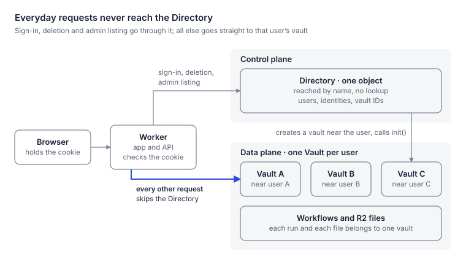
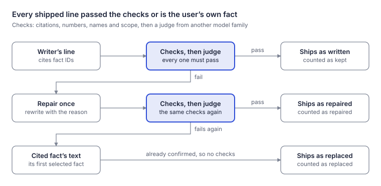
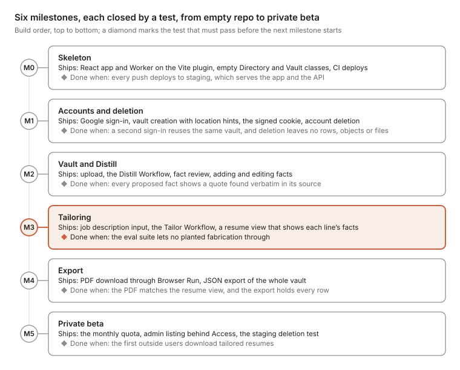

# Resumatic v1: Codebase Plan

> Exported on 2026-11-04 from the living design document. Diagrams are rendered snapshots in [diagrams](diagrams).

Nov 4, 2026 · @Evan Klein

## What v1 is

v1 is one Worker, two Durable Object classes and two Workflows, serving the job-seeker product alone. A user uploads resumes, confirms the facts Resumatic pulls out, pastes a job description and downloads a tailored resume. Every line of that resume traces to a fact the user confirmed.

- **In v1:** sign-in with one OpenID Connect provider (Google is assumed below), PDF and DOCX upload, fact review, tailoring with grounding checks, PDF download, data export, account deletion, and a fixed monthly tailoring quota per user.
- **Kept from the full design:** the no-invention rule. Each fact keeps a verbatim quote from its source, the writer sees only the facts selected for the job, and a line that fails its checks never ships.
- **Left for later:** the recruiter marketplace, EU residency, billing, live progress, the Agents SDK, fleet operations, and vault restore or move. [Section 10](#deferred-features) shows where each one attaches.

Against the [technical architecture](technical-architecture.md), v1 drops D1, KV, Queues, Vectorize, Secrets Store and three of its four Workers. The control plane moves from D1 into a Durable Object, because that is what the reference pattern prescribes.

## How v1 follows the pattern

v1 has one resource type, the vault, so it has one control plane object (the Directory) and one data plane object per user (the Vault). The Directory is called at sign-in, at account deletion and for admin listing; every other request goes from the Worker straight to the user's vault.



The Directory sees only sign-in, deletion and admin calls; the accent path carries everything else and never passes through it.

| The reference says | v1 does | Code |
| --- | --- | --- |
| At least one control plane object per resource type, reached by name so no lookup is needed | One `Directory` object, reached with `idFromName("global")` | `src/directory/directory.ts` |
| The control plane sits where its first request lands, or where an explicit hint puts it | A fixed location hint, chosen at launch, pins the Directory | `src/shared/stubs.ts` |
| The control plane creates each data object near its user with a location hint | `signIn` calls `VAULT.newUniqueId()`, then `VAULT.get(id, { locationHint })` with a hint from `request.cf`; only that first `get` honours it | `src/directory/directory.ts`, `src/shared/location.ts` |
| An optional `init(...)` stores what the data object needs | `Vault.init(userId)` records the owner; the vault refuses user and Workflow calls until it has run | `src/vault/vault.ts` |
| The control plane keeps each identifier so it can list or delete | The `vaults` table, read by `listVaults` and `deleteAccount` | `src/directory/directory.ts` |
| A random identifier goes back to the client for later requests | The vault ID rides in the signed session cookie | `src/worker/session.ts` |
| The Worker routes data requests straight to the data object | Every `/api/*` route calls `VAULT.get(VAULT.idFromString(vid))`, with no Directory hop | `src/worker/routes.ts` |
| The data object reads and writes its own storage | Facts, quotes, vectors, applications and resumes live in the vault's SQLite; files sit in R2 under `vaults/<vaultId>/` | `src/vault/` |
| Data must shard into self-contained resources | One vault holds one user's whole record, so no request needs two vaults | none |
| Split the control plane when load requires it | Not needed at v1 load; a split is by name, so nothing else changes ([section 10](#deferred-features)) | none |
| (Not covered: background work) | Distill and Tailor runs carry one vault ID and call back only into that vault, so they stay on the data plane | `src/workflows/` |

v1 uses random vault IDs rather than names. No email or provider ID can address a vault, and the Directory row is the only link from a person to their data, so deleting it severs that link.

## Repository layout

One package and one deploy: the React app, the API, both Durable Object classes and both Workflows ship as a single Worker.

```text
resumatic.app/
├── .github/workflows/
│   ├── ci.yml                test on every push; deploy main to staging, then the end-to-end check
│   └── evals.yml             no-fabrication evals on prompt, pipeline or grounding changes, and nightly
├── wrangler.jsonc            one Worker: assets, API, 2 Durable Object classes, 2 Workflows
├── vite.config.ts            React app + Worker through the Cloudflare Vite plugin
├── vitest.config.ts          unit tests in Node, integration tests in workerd, evals on request
├── index.html                Vite entry page for the React app
├── public/_headers           CSP and other headers for the static app
├── scripts/e2e-staging.mjs   end-to-end check against the deployed staging Worker
├── package.json
├── src/
│   ├── env.d.ts              secrets, which wrangler types cannot see
│   ├── worker/
│   │   ├── index.ts          fetch handler; exports Directory, Vault and both Workflows
│   │   ├── routes.ts         Hono routes: /auth/*, /api/*, /admin/*
│   │   ├── session.ts        sign and verify the session cookie (HMAC-SHA256)
│   │   ├── oidc.ts           Google sign-in: redirect, code exchange, ID-token check
│   │   ├── jwt.ts            RS256 token verification against a cached key set
│   │   ├── access.ts         Cloudflare Access token check for /admin/*
│   │   └── crypto.ts         base64url, HMAC tokens, constant-time comparison
│   ├── directory/            control plane
│   │   ├── directory.ts      class Directory extends DurableObject
│   │   └── schema.ts         tables and migrations, run on wake
│   ├── vault/                data plane
│   │   ├── vault.ts          class Vault extends DurableObject
│   │   ├── schema.ts         tables and migrations, run on wake
│   │   └── search.ts         cosine search over the vault's own vectors
│   ├── workflows/
│   │   ├── distill.ts        class DistillWorkflow extends WorkflowEntrypoint
│   │   ├── tailor.ts         class TailorWorkflow extends WorkflowEntrypoint
│   │   └── steps.ts          retry settings; final errors become NonRetryableError
│   ├── pipeline/             the steps' logic, with models passed in, so evals run it from Node
│   │   ├── distill.ts        extract facts and drop what the document does not support
│   │   └── tailor.ts         analyze, select, write, verify, compose
│   ├── grounding/            pure TypeScript: no Cloudflare imports, no I/O
│   │   ├── quote.ts          a quote must appear verbatim in its source
│   │   ├── claims.ts         numbers, names and scope verbs must match the evidence
│   │   └── verdict.ts        a line's citations and claims; the fallback fact
│   ├── ai/
│   │   ├── models.ts         the Models interface, model routing, and the setModels test seam
│   │   ├── llm.ts            one call path to chat models through AI Gateway, JSON out
│   │   ├── prompts.ts        extract, analyze, write, judge, repair, with their output schemas
│   │   └── vectors.ts        bge-m3 embeddings, the bge reranker and toMarkdown on Workers AI
│   ├── render/
│   │   ├── template.ts       resume JSON to HTML; headers printed from vault rows
│   │   └── pdf.ts            HTML to PDF with Browser Run, and the setPdfRenderer test seam
│   ├── shared/
│   │   ├── api.ts            the HTTP contract: routes, request and response types, limits
│   │   ├── errors.ts         AppError codes that survive RPC, and their HTTP statuses
│   │   ├── types.ts          RPC argument and pipeline types
│   │   ├── stubs.ts          directory(env) and vault(env, vaultId) stub helpers
│   │   ├── r2.ts             R2 keys under vaults/<vaultId>/, and prefix deletion
│   │   └── location.ts       request.cf to a location hint
│   └── web/                  React app, built by Vite, served as static assets
└── test/
    ├── unit/                 grounding, sessions, tokens, chat client, template, pipelines
    ├── integration/          routes, Directory, Vault and both Workflows inside workerd
    ├── support/              the fixture resume, stand-in models, test signing keys
    └── evals/                resumes and job descriptions with planted fabrication traps
```

- Only `routes.ts` speaks HTTP. Durable Objects and Workflows are reached through RPC on their bindings.
- `grounding/` imports nothing from Cloudflare, so its tests run in plain Node and the same checks serve both Workflows.
- `shared/stubs.ts` is the one place that builds stubs, so the rule "the Directory is never on the data path" is visible in one file.

## Control plane: the Directory

The Directory is one SQLite-backed Durable Object that maps a sign-in identity to a user, and a user to a vault ID. It holds no career data.

```sql
-- src/directory/schema.ts, version 1
CREATE TABLE users (
  user_id    TEXT PRIMARY KEY,          -- random; never shown to anyone
  email      TEXT NOT NULL,
  state      TEXT NOT NULL,             -- active | deleting
  created_at INTEGER NOT NULL
);
CREATE TABLE identities (
  provider   TEXT NOT NULL,             -- 'google'
  subject    TEXT NOT NULL,             -- the ID token's sub claim
  user_id    TEXT NOT NULL REFERENCES users (user_id),
  PRIMARY KEY (provider, subject)
);
CREATE TABLE vaults (
  vault_id   TEXT PRIMARY KEY,          -- DurableObjectId.toString()
  user_id    TEXT NOT NULL UNIQUE REFERENCES users (user_id),
  hint       TEXT NOT NULL,             -- the location hint used at creation
  state      TEXT NOT NULL,             -- creating | active | deleting | swept
  swept_at   INTEGER,                   -- first R2 sweep; the rows go SWEEP_DELAY_MS later
  updated_at INTEGER NOT NULL
);
CREATE TABLE invites (
  email      TEXT PRIMARY KEY,          -- lower case
  created_at INTEGER NOT NULL
);
```

```ts
// src/directory/directory.ts
export class Directory extends DurableObject<Env> {
  /** Find or create the user and their vault. Safe to repeat. */
  signIn(p: { provider: 'google' | 'test'; subject: string; email: string; hint: LocationHint }):
    Promise<{ userId: string; vaultId: string }>;

  /** Mark the account for deletion; alarm() does the work. */
  deleteAccount(userId: string): Promise<void>;

  /** Admin: page through vaults in ID order, and manage the beta invite list. */
  listVaults(p: { after?: string; limit: number }): Promise<VaultRow[]>;
  addInvite(email: string): Promise<void>;
  removeInvite(email: string): Promise<void>;
  listInvites(): Promise<{ email: string; createdAt: number }[]>;

  /** Runs pending deletions and retries any that failed. */
  alarm(): Promise<void>;
}
```

- `signIn` inserts the user, identity and vault rows before its first `await`. `newUniqueId()` is synchronous, so a second sign-in racing the first finds the rows and gets the same vault.
- It then calls `init(userId)` on `VAULT.get(id, { locationHint: hint })`. That first call creates the vault near the user, and the vault does not move after that.
- `init` is safe to repeat, so a sign-in that finds a vault still `creating` calls it again, then marks it `active`.
- Session cookies last seven days, so an active user reaches the Directory about once a week. Deletion and admin listing are its only other callers.
- While `INVITE_ONLY` is `"true"`, a new Google identity needs an invite. Staging's test sign-in (`provider: 'test'`, behind the `TEST_SIGNIN_KEY` secret) skips the list so the end-to-end check can make fresh accounts.
- `/admin/vaults` and `/admin/invites` call the Directory and sit behind Cloudflare Access; the Worker also verifies the Access token on each call.

## Data plane: the Vault

Each user gets one Vault, a SQLite-backed Durable Object holding their whole career record: sources, quotes, facts, vectors, applications and resumes. Uploaded files live in R2 under `vaults/<vaultId>/`.

```sql
-- src/vault/schema.ts, version 1
CREATE TABLE meta (key TEXT PRIMARY KEY, value TEXT NOT NULL);
  -- user_id, session_gen, state (open | closing), schema_version, quota_month, quota_used
CREATE TABLE profile (
  id INTEGER PRIMARY KEY CHECK (id = 1),
  name TEXT, email TEXT, phone TEXT, location TEXT, links TEXT   -- links: JSON array
);
CREATE TABLE sources (
  id TEXT PRIMARY KEY, filename TEXT NOT NULL, r2_key TEXT NOT NULL,
  markdown TEXT,                              -- set by Distill's convert step
  state TEXT NOT NULL,                        -- queued | ready | failed
  error TEXT,                                 -- a short message for the user; never career text
  run_id TEXT, created_at INTEGER NOT NULL
);
CREATE TABLE evidence (
  id TEXT PRIMARY KEY,
  source_id TEXT NOT NULL REFERENCES sources (id),
  quote TEXT NOT NULL                         -- verbatim from sources.markdown
);
CREATE TABLE roles (
  id TEXT PRIMARY KEY,
  kind TEXT NOT NULL,                         -- job | education | project | volunteer
  org TEXT NOT NULL, title TEXT, start_date TEXT, end_date TEXT,
  evidence_id TEXT REFERENCES evidence (id),
  source_id TEXT,                             -- the upload it came from
  state TEXT NOT NULL                         -- proposed | confirmed | rejected
);
CREATE TABLE facts (
  id TEXT PRIMARY KEY,
  role_id TEXT REFERENCES roles (id),         -- NULL for skills not tied to a role
  kind TEXT NOT NULL,                         -- accomplishment | skill | credential
  text TEXT NOT NULL,
  level TEXT,                                 -- contributed | implemented | led | owned | founded
  evidence_id TEXT REFERENCES evidence (id),  -- NULL when the user typed the fact
  source_id TEXT,                             -- the upload it came from
  origin TEXT NOT NULL,                       -- extracted | user
  state TEXT NOT NULL,                        -- proposed | confirmed | rejected
  vector BLOB,                                -- bge-m3: 1,024 float32 values
  updated_at INTEGER NOT NULL
);
CREATE TABLE applications (
  id TEXT PRIMARY KEY, company TEXT, title TEXT,
  jd_text TEXT NOT NULL,
  requirements TEXT,                          -- JSON, from Tailor's analyze step
  created_at INTEGER NOT NULL
);
CREATE TABLE resumes (
  id TEXT PRIMARY KEY,
  application_id TEXT NOT NULL REFERENCES applications (id),
  state TEXT NOT NULL,                        -- running | ready | failed
  step TEXT,                                  -- last finished Tailor step, shown while polling
  error TEXT,                                 -- a short message for the user when state is failed
  selection TEXT, report TEXT,                -- JSON
  draft TEXT, verified TEXT,                  -- JSON lines before and after verify; never shown
  body TEXT,                                  -- JSON resume built from verified lines; shown once ready
  version INTEGER NOT NULL DEFAULT 1,         -- bumped by editLine; part of the PDF's R2 key
  quota_month TEXT,                           -- the month this run was counted against, for refunds
  run_id TEXT, created_at INTEGER NOT NULL
);
```

```ts
// src/vault/vault.ts — `who` is { userId, gen } from the verified cookie
export class Vault extends DurableObject<Env> {
  // Lifecycle: called by the Directory; close and destroy skip the open check
  init(userId: string): Promise<void>;                         // creates the schema, records the owner
  close(): Promise<{ distill: string[]; tailor: string[] }>;   // idempotent: refuse new work, list runs
  destroy(): Promise<void>;                                    // deleteAlarm(), deleteAll(), mark gone in memory

  // Sessions: called by the Worker
  openSession(userId: string): Promise<{ gen: number }>;
  checkSession(who: Who): Promise<void>;                       // throws unless who matches; run before deletion
  signOutEverywhere(who: Who): Promise<void>;                  // bumps session_gen

  // User calls: one per /api route (types in src/shared/api.ts)
  me(who: Who): Promise<Me>;                                   // profile and quota
  getProfile(who: Who): Promise<Profile>;
  updateProfile(who: Who, p: Partial<Profile>): Promise<Profile>;
  addSource(who: Who, s: { filename: string; r2Key: string }): Promise<{ sourceId: string }>;
  listSources(who: Who): Promise<SourceView[]>;
  sourceFile(who: Who, sourceId: string): Promise<{ r2Key: string; filename: string }>;  // download the original
  listRoles(who: Who): Promise<RoleView[]>;
  addRole(who: Who, r: NewRole): Promise<{ roleId: string }>;                     // the user's own: confirmed, no quote
  editRole(who: Who, id: string, patch: RolePatch): Promise<void>;
  listFacts(who: Who, state?: ReviewState): Promise<FactView[]>;                 // each with its quote
  review(who: Who, r: { confirm: string[]; reject: string[] }): Promise<void>;   // role or fact IDs
  addFact(who: Who, f: NewFact): Promise<{ factId: string }>;                     // embeds before saving
  editFact(who: Who, id: string, patch: FactPatch): Promise<void>;                // new text (re-embeds), another role, or both
  addApplication(who: Who, jdText: string): Promise<{ applicationId: string }>;
  listApplications(who: Who): Promise<ApplicationView[]>;
  tailor(who: Who, applicationId: string): Promise<{ resumeId: string }>;
  getResume(who: Who, id: string): Promise<ResumeView>;                           // body only once ready
  editLine(who: Who, resumeId: string, lineId: string, text: string): Promise<void>;
  renderData(who: Who, resumeId: string): Promise<RenderData>;                    // for the PDF route
  exportAll(who: Who): Promise<VaultExport>;

  // Workflow calls: return small results, so Workflow state holds no career text
  sourceInfo(sourceId: string): Promise<{ r2Key: string; filename: string }>;
  sourceText(sourceId: string): Promise<string>;
  saveSource(sourceId: string, patch: { markdown?: string; state?: SourceState; error?: string | null }): Promise<void>;
  saveExtraction(sourceId: string, x: Extraction): Promise<{ roles: number; facts: number }>;
  unembeddedFacts(sourceId: string): Promise<{ id: string; text: string }[]>;
  saveVectors(v: { factId: string; vector: number[] }[]): Promise<void>;
  tailorInput(resumeId: string): Promise<TailorInput>;
  saveAnalysis(applicationId: string, a: Analysis): Promise<void>;
  searchFacts(queries: number[][], k: number): Promise<Candidate[]>;
  saveStep(resumeId: string, step: string, patch: ResumePatch): Promise<void>;
  failResume(resumeId: string, error: string): Promise<void>;                    // refunds the quota
}
```

- Every method except `close` and `destroy` first checks that the vault is initialised and open. User calls also compare `who.userId` and `who.gen` with `meta`: a stale cookie gets HTTP 401, a destroyed vault HTTP 410.
- Expected failures are `AppError`s with a code (`unauthenticated`, `forbidden`, `not_found`, `conflict`, `gone`, `invalid`, `too_large`, `quota`, `unavailable`). RPC keeps only an error's message, so the code leads the message (`"gone: …"`); the Worker maps it to an HTTP status and a JSON body `{ error, message }`, and a Workflow step turns a final code into a `NonRetryableError`.
- Only `init` creates the schema. On wake, the constructor runs migrations under `blockConcurrencyWhile` only if `meta` exists, so a destroyed vault stays empty.
- `searchFacts` ranks confirmed facts by cosine similarity from an in-memory cache of their vectors, dropped on any change to a confirmed fact. A few thousand vectors per user need no index service.
- `addFact` and `editFact` embed the text before saving. An edited or moved fact becomes `origin: 'user'`, the user's own claim, with the original quote kept beside it. Roles the user adds start confirmed, like facts they type.
- `listSources` and `tailor` check any source or resume still running after 30 minutes against its Workflow, and mark it failed if the run has stopped, so nothing shows as in progress forever.
- `tailor` counts the quota and writes the `running` row before its first `await`; if `TAILOR.create()` throws, it marks the row `failed` and refunds the quota. A `running` row older than 30 minutes is checked with `TAILOR.get(id).status()` before it can block a new run.
- Source and resume IDs come from `crypto.randomUUID()`, because they double as Workflow instance IDs, which must be unique across all vaults.
- Workflow calls are idempotent: `saveExtraction` replaces earlier proposals from the same source in one transaction, so a retried step never duplicates facts.

## Pipelines: Distill, Tailor and the grounding checks

Both pipelines are Workflows started by the vault. Each step reads from the vault, writes its result back, and returns only IDs and counts.

**Distill:** one run per upload; the instance ID is the source ID.

1. `convert`: read the upload from R2 and turn it into Markdown with `env.AI.toMarkdown()`, which accepts PDF and DOCX. Save it on the source row.
2. `extract`: a mid-size model returns roles and facts as JSON, each with a verbatim quote and a scope level. Items failing the Quote, Numbers, Names or Scope checks below are dropped; the rest are saved as `proposed`.
3. `embed`: bge-m3 vectors for the new facts, saved on their rows.

The user then confirms, edits or rejects each proposed fact. Only confirmed facts reach a resume.

**Tailor:** one run per resume; the instance ID is the resume ID.

1. `analyze`: a small model turns the job description into a list of requirements, plus the title and company, saved with `saveAnalysis`.
2. `select`: the requirements are embedded, `searchFacts` returns the closest confirmed facts, and the bge reranker orders them. The best facts per role are kept within a one-page budget, and requirements with no match are recorded as gaps.
3. `write`: a frontier model with no tools sees only the selected facts and the requirements. It returns lines as JSON, each citing fact IDs, into the resume's `draft`, which the app never shows. It never writes headers: organisations, titles, dates and education print from vault rows.
4. `verify`: each line must pass every check below, or is repaired once, or is replaced by the first fact it cites that was selected (drawn below). A line with no such fact is dropped and reported.
5. `finish`: move the verified lines into `body`, save a report (lines kept, repaired, replaced and dropped, plus gaps) and mark the resume `ready`.

| Check | Passes when | Runs in |
| --- | --- | --- |
| Quote | The quote appears verbatim in the source Markdown, after whitespace and punctuation are normalised | Distill |
| Citations | The line cites at least one fact, and every cited fact is in the selection | Tailor |
| Numbers | Every number, percentage, amount and date appears with the same value in the evidence | Both |
| Names | Every proper name or technical term (a capitalised word other than the first, or a word with digits or symbols) appears in the evidence | Both |
| Scope | The lead verb's level is no higher than the evidence's: contributed < implemented < led < owned < founded | Both |
| Judge | A model from a different family than the writer labels the line `supported`; it sees the line and its facts, never the job description | Tailor |

Evidence means the quote during Distill and the cited facts during Tailor. The checks live in `src/grounding/` and run the same way in both pipelines.



A line reaches the resume in one of three ways, and the run's report counts each one.

- Model output that fails its JSON schema gets one retry with the error attached. After that the step throws and the Workflow's own retries take over.
- When a step exhausts its retries, `run()` catches the error and marks the source or resume `failed`, so no upload polls forever and nothing unverified is ever shown.
- `llm.ts` posts to AI Gateway's OpenAI-compatible REST endpoint (`/ai/v1/chat/completions`) with `provider/model` names, `cf-aig-gateway-id` and `cf-aig-collect-log-payload: false`. Gateway logs keep token counts and latency but no career text.
- Third-party models are paid through Unified Billing, so the Worker holds one Cloudflare API token and no provider keys.

## Key flows

Five flows cover v1, and only sign-in and deletion reach the Directory.

**First sign-in**

1. `/auth/login` sets a short-lived `__Host-oidc` cookie holding `state`, `nonce` and a PKCE verifier, then redirects to Google, which returns to `/auth/callback` with a code.
2. The Worker checks `state`, exchanges the code with the PKCE verifier, verifies the ID token and its `nonce`, and maps `request.cf` to a location hint.
3. `directory.signIn(...)` writes the rows, creates the vault near the user, calls `init`, and returns `{ userId, vaultId }`. A returning user just gets the stored IDs; the Directory does not call the vault.
4. The Worker calls `vault.openSession(userId)` for the session generation, then sets the HMAC-signed `__Host-session` cookie holding `{ uid, vid, gen, exp }` (`HttpOnly; Secure; SameSite=Lax`) and redirects to the app.

**Everyday request**, for example `GET /api/facts`

1. The Worker verifies the cookie in memory, with no storage read.
2. It calls `listFacts(who)` on `VAULT.get(VAULT.idFromString(vid))`. The vault checks `who` and reads its own SQLite.

**Upload**

1. `POST /api/sources` checks the type and size (PDF or DOCX, at most 10 MB) and writes the file to R2 under `vaults/<vid>/sources/`.
2. `vault.addSource` records it and starts Distill. If the vault refuses, the Worker deletes the object.
3. The app polls `GET /api/sources` until the source is `ready`, then opens fact review.

**Tailoring**

1. `POST /api/applications` saves the job description in the vault.
2. `POST /api/applications/:id/resumes` calls `vault.tailor`, which checks the quota and starts Tailor.
3. The app polls `GET /api/resumes/:id` every two seconds. It sees each finished step, and the lines only once the resume is `ready`.
4. `GET /api/resumes/:id/pdf` renders through Browser Run and caches the PDF in R2 as `vaults/<vid>/exports/<resumeId>-<version>.pdf`. `editLine` bumps the version, so a render that raced an edit is never served as current. `GET /api/resumes/:id/preview` returns the same HTML for a print preview, under a CSP that blocks scripts and every outside resource.

**Account deletion**

1. `DELETE /auth/account` first calls `vault.checkSession(who)`, so a revoked cookie cannot delete the account. It then calls `directory.deleteAccount(uid)`, which marks the user and vault `deleting` and refuses sign-in from then on. The Worker clears the cookie.
2. The Directory's alarm calls `vault.close()`, then terminates each Distill and Tailor run it returns, skipping runs that are missing or already finished.
3. It deletes every R2 object under `vaults/<vid>/`, then calls `vault.destroy()`. The vault goes last, so a retry after any failure can still ask it which runs to stop.
4. After `SWEEP_DELAY_MS` (an hour in production) the alarm sweeps the R2 prefix again, catching any upload that raced the deletion, and then deletes the Directory rows.

## Configuration

One `wrangler.jsonc` declares the whole system: two Durable Object classes, two Workflows, one R2 bucket, Workers AI and Browser Run.

```jsonc
{
  "$schema": "./node_modules/wrangler/config-schema.json",
  "name": "resumatic",
  "main": "src/worker/index.ts",
  "compatibility_date": "2026-11-01",
  "compatibility_flags": ["nodejs_compat"],
  "assets": {                                   // the Vite plugin supplies the directory
    "binding": "ASSETS",
    "not_found_handling": "single-page-application",
    "run_worker_first": ["/api/*", "/auth/*", "/admin/*"]
  },
  "durable_objects": {
    "bindings": [
      { "name": "DIRECTORY", "class_name": "Directory" },
      { "name": "VAULT", "class_name": "Vault" }
    ]
  },
  "exports": {                                  // declarative; replaces the legacy migrations array
    "Directory": { "type": "durable-object", "storage": "sqlite" },
    "Vault": { "type": "durable-object", "storage": "sqlite" }
  },
  "workflows": [
    { "name": "distill", "binding": "DISTILL", "class_name": "DistillWorkflow" },
    { "name": "tailor", "binding": "TAILOR", "class_name": "TailorWorkflow" }
  ],
  "r2_buckets": [{ "binding": "FILES", "bucket_name": "resumatic-files" }],
  "ai": { "binding": "AI", "remote": true },
  "browser": { "binding": "BROWSER" },
  "vars": {
    "DIRECTORY_HINT": "<location hint chosen at launch>",
    "SWEEP_DELAY_MS": "3600000",               // second R2 sweep after a deletion
    "INVITE_ONLY": "true",                     // "false" opens sign-up
    "TAILOR_MONTHLY_LIMIT": "20",
    "OIDC_CLIENT_ID": "<google-client-id>",
    "CF_ACCOUNT_ID": "<account-id>",
    "AI_GATEWAY_ID": "resumatic",
    "MODEL_EXTRACT": "anthropic/claude-haiku-5.5",
    "MODEL_ANALYZE": "anthropic/claude-haiku-5.5",
    "MODEL_WRITE": "anthropic/claude-sonnet-5.5",
    "MODEL_JUDGE": "openai/gpt-5",             // a different family from the writer
    "ACCESS_TEAM_DOMAIN": "https://<team>.cloudflareaccess.com",
    "ACCESS_AUD": "<access-application-audience>"
  },
  "observability": { "logs": { "enabled": true } }
}
```

| Secret | Read by | Purpose |
| --- | --- | --- |
| `SESSION_KEY` | `session.ts` | HMAC-SHA256 key for session cookies |
| `OIDC_CLIENT_SECRET` | `oidc.ts` | Google code exchange |
| `CF_AI_TOKEN` | `llm.ts` | Cloudflare API token with Workers AI Read, for the gateway's chat endpoint |
| `TEST_SIGNIN_KEY` | `routes.ts` | Staging only: turns on `POST /auth/test-login` for the end-to-end check. Never set in production |

- Set each secret with `wrangler secret put`; nothing secret sits in the config file.
- Embeddings and the reranker use the `AI` binding with `{ gateway: { id: AI_GATEWAY_ID, collectLog: false } }`, so those calls leave no log entry holding career text.
- Staging is a second Worker, `resumatic-staging`, built with `CLOUDFLARE_ENV=staging vite build` and deployed with `wrangler deploy`; the Vite plugin fixes the environment at build time. Its `env.staging` block repeats the bindings, which environments do not inherit, with its own R2 bucket, Workflow names and a one-minute `SWEEP_DELAY_MS`.
- Version preview URLs are no substitute: Cloudflare does not generate them for Workers that implement a Durable Object.
- Every release goes out through `wrangler deploy`: the docs say gradual deployments are not supported for a Worker that declares `exports`.
- Workers AI runs only remotely, so local dev keeps remote bindings off unless asked: `npm run dev:remote`, after `wrangler login`.

## Testing and build order

v1 is built in six milestones, each ending in a test that must pass before the next begins. Account deletion lands in the second milestone, before any career data exists.



M3's gate is the one that matters most: tailoring does not ship while any planted fabrication gets through.

| Layer | What it proves | Tool | Runs |
| --- | --- | --- | --- |
| Unit | Grounding checks, cookie signing, token verification, the chat client, the template, the pipelines with stand-in models | Vitest in Node | Every commit |
| Integration | Sign-in reuses one vault; sessions and sign-out everywhere; Google and Access tokens; both Workflows end to end with their grounding report; quota and one run at a time; PDF caching per version; deletion stops runs and erases R2 and the vault | `@cloudflare/vitest-plugin`, with stand-in models, renderer and Google | Every commit |
| Evals | No planted fabrication reaches a resume: skills the job wants but the user lacks, inflated numbers, raised seniority, instructions hidden in a resume or a job description | Vitest against live models through AI Gateway (`npm run evals`) | Prompt, pipeline or grounding changes, and nightly |
| Staging | Sign-in, upload, Distill, Tailor, PDF, export and deletion against the deployed Worker with the real models and Browser Run | `scripts/e2e-staging.mjs` | After every staging deploy |

## Deferred features

Each later feature adds a resource type with its own control plane, splits the Directory by name, or adds code inside the vault. None puts the Directory back on the data path.

| Later feature | Where it attaches | Build it when |
| --- | --- | --- |
| Live progress | The vault accepts a WebSocket through the hibernation API and pushes each finished step, replacing polling | Polling cost or lag shows up |
| Billing | A Stripe webhook updates the plan in the Directory, which pushes it to a new `vault.setPlan`; the quota check already lives in the vault | Before charging anyone |
| EU residency | EU vaults come from `VAULT.jurisdiction("eu").newUniqueId()`, with an EU R2 bucket and EU Workflow classes; the Directory records each vault's jurisdiction | Before marketing in the EU |
| Split control plane | Directory shards reached by name, `idFromName("directory:" + shard)`, with the shard derived from the identity, so sign-in still needs no lookup | Sign-in load nears what one object can serve |
| Recruiter marketplace | A second resource type: an `OrgDirectory` control plane and one `Org` object per recruiting firm, the same pattern applied again. A seeker shares a consented profile out of their vault | Seekers return and ask for introductions |
| Vault restore and move | Restore uses the vault's own point-in-time recovery. A move creates a vault at the target, copies through export and import, swaps the ID in the Directory and destroys the old one | Support needs it |
| Fleet operations | The Directory pages through `vaults` and calls each one, for example to re-embed facts after a model change | The first embedding-model change |
| Agents SDK | The Vault can extend the Agent class for chat-style coaching; the boundary between the planes stays where it is | A chat feature is planned |

## Sources

- [Control and data plane pattern for Durable Objects](https://developers.cloudflare.com/reference-architecture/diagrams/storage/durable-object-control-data-plane-pattern/), Cloudflare reference architecture
- [Durable Objects data location](https://developers.cloudflare.com/durable-objects/reference/data-location/): location hints and jurisdictions
- [Durable Object class exports](https://developers.cloudflare.com/durable-objects/reference/durable-objects-migrations/): the declarative `exports` field
- [Workflows Workers API](https://developers.cloudflare.com/workflows/build/workers-api/): `create`, `get`, `terminate` and instance retention
- [Workers Static Assets](https://developers.cloudflare.com/workers/static-assets/): the Vite plugin, `run_worker_first`, single-page apps
- [Preview URLs](https://developers.cloudflare.com/workers/configuration/previews/): not generated for Workers that implement a Durable Object
- [Markdown conversion supported formats](https://developers.cloudflare.com/workers-ai/features/markdown-conversion/supported-formats/): PDF and DOCX
- [AI Gateway REST API](https://developers.cloudflare.com/ai-gateway/usage/rest-api/) and [Unified API (OpenAI compat)](https://developers.cloudflare.com/ai-gateway/usage/chat-completion/): the chat endpoint, model names, Unified Billing
- [AI Gateway logging](https://developers.cloudflare.com/ai-gateway/observability/logging/) and [Worker binding methods](https://developers.cloudflare.com/ai-gateway/usage/worker-binding-methods/): `cf-aig-collect-log-payload` and `collectLog`
- Resumatic repository: [technical architecture](technical-architecture.md), [system design](system-design.md) and [design review](design-review-2026-11.md)
